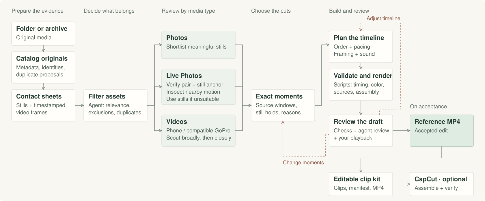
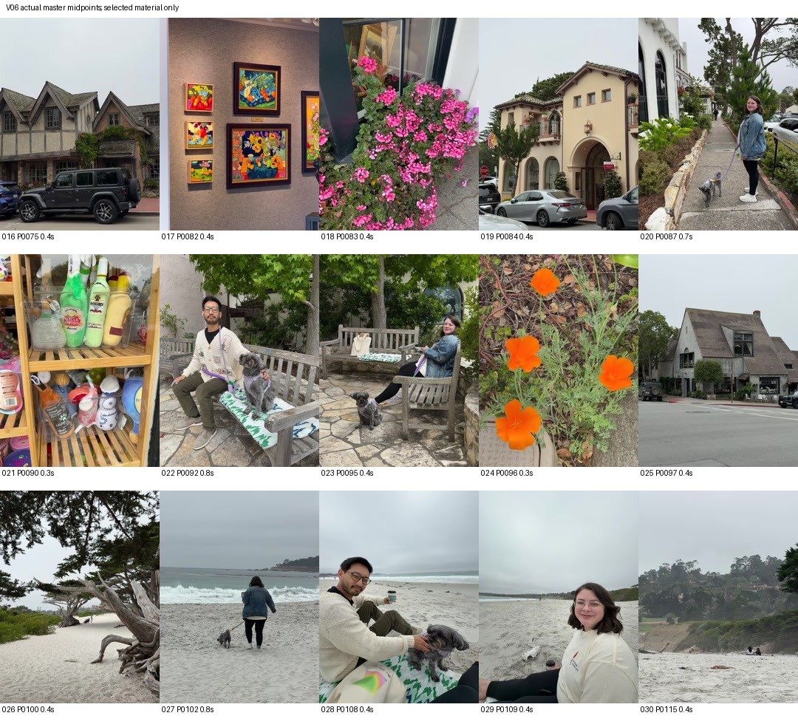
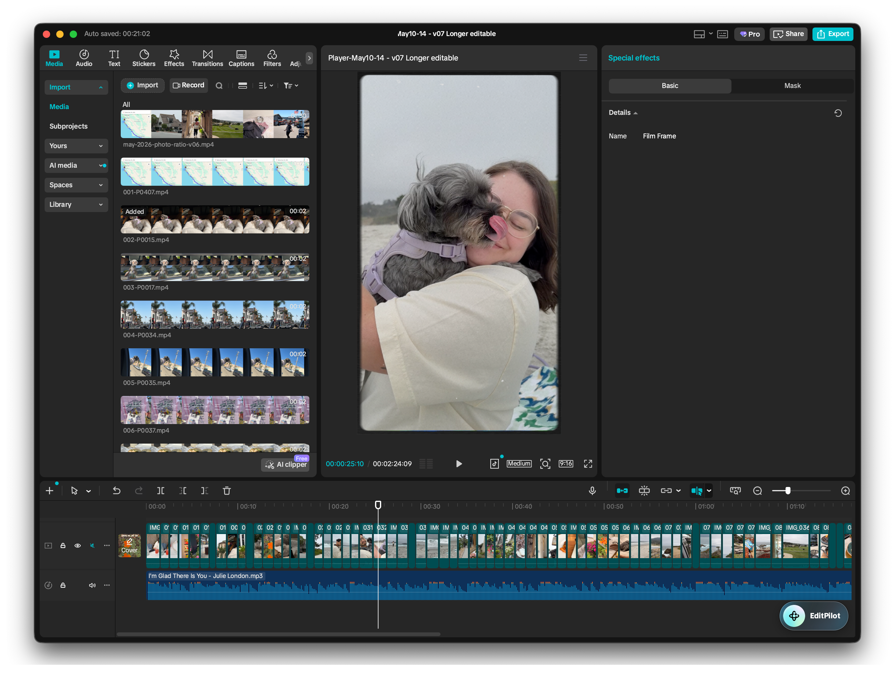

# Montage Agent Skill

An agent skill for creating montages from photos, Live Photos, and videos, with optional editable handoffs.

[Explainer Video](https://drive.google.com/file/d/1pjr_U-lLN8tP6xqgwIvJn3tQ7iAVOF3H/view?usp=drivesdk) · [Example Result](https://drive.google.com/file/d/1C3Xrtr9U06JoC5iLx07R1_5kCdPS2lbO/view?usp=drivesdk)

**🤬 Problem:** Your camera roll is full of footage from a recent trip. You know the rough date range, but it also contains random twitter screenshots and irrelevant pics from friends. Sorting through and curating everything takes enough effort that you keep putting it off.

**🥰 Solution:** Describe the vibe you want and point this skill at your footage. The agent sorts through it, chooses the best moments, and builds a draft for you to review.

## The workflow

1. Describe the vibe you're going for and point the agent to the directory containing your footage. **You do not need to curate, organize, or filter out irrelevant footage; the agent will handle this.**

   > **Example prompt:** Create a montage of my road trip using the photos and videos from May 10–17 in my Google Photos export. Ignore screenshots and unrelated downloads. Keep it under two minutes.

2. The agent catalogs the footage and generates contact sheets.
3. The agent chooses the best moments from photos, videos, and Live Photos, skipping duplicates and irrelevant footage.
4. The agent arranges the selected shots and sets their timing and framing.
5. The agent renders the draft, watches it, and revises it.
6. The agent delivers the reference MP4.
7. [Optional] The agent stages the clips for further editing in your preferred program. This step requires Computer Use.

## Optional editable handoff

The agent can stage each clip to be edited separately in a program of your choice (requires Computer Use). The example above shows the montage in CapCut, with music and film effects added afterward.

## Installation

Copy [`skills/montage/`](skills/montage/) into your agent's skills directory. Requires Python 3.9+, FFmpeg, and ffprobe. See [photo and Live Photo requirements](skills/montage/references/media.md) for those inputs.

After installation, invoke `$montage` in Codex or `/montage` in Claude Code, followed by your request and the location of your footage.

Keep your footage and working files outside this repository.

## Token efficiency

A few strategies help keep the montage process token efficient:

- **Offload to scripts.** Scripts handle extraction, metadata, trimming, color conversion, and rendering. The agent focuses on choosing moments and shaping the edit.
- **Group duplicates early.** Identify exact copies before visual review and compare similar shots together, preserving the originals.
- **Start with contact sheets.** These grids of small preview images let the agent check privacy, relevance, duplicates, and quality together. Open individual images when details need a closer look.
- **Scout broadly, then closely.** Sample across each video's full duration, then inspect promising windows more densely. Play selected clips to check motion and sound.
- **Use prompt caching.** Keep repeated instructions and reference material consistent, and append new requests so you can reuse cached context. In our montage example, ~97% of input tokens were served from cache.
- **Use Live Photo timing.** Verify the still/motion pair and capture time, then inspect nearby motion for a clean window.
- **Save and reuse work.** The agent saves selected moments, clip timings, and prepared clips so revisions don’t require reviewing the same footage again.

## License

The skill, code, and documentation are released under the [Unlicense](LICENSE). You can use, modify, and redistribute them, including commercially, without attribution.

Example photos, screenshots, and videos are included for demonstration and are not covered by this license.
